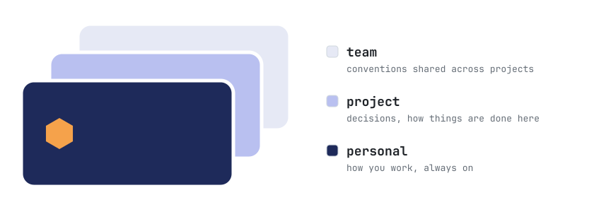

<p align="center">
  <picture>
    <source media="(prefers-color-scheme: dark)" srcset="docs/assets/kioku-hero-dial-dark.svg">
    
  </picture>
</p>

# Kioku

[](https://github.com/monoku/kioku/actions/workflows/ci.yml)

Memory for coding agents, kept in **brains**: git repositories of Markdown
pages, yours and your team's. Your agent reads the brains at the start of every
session and saves to them on its own while it works: corrections, preferences,
decisions and why, errors and how they were resolved, context the code does not
hold. Nothing asks "save this?". You see each read and write as a row in the
conversation, `⬢ kioku.md ↑ saved …`, and you correct the memory afterwards by
talking to the agent: "what did you save today?", "that's wrong", "forget
that".

## Install

You need Node 24 or later and git; nothing needs GitHub or an account.

```bash
curl -fsSL https://raw.githubusercontent.com/monoku/kioku/main/install.sh | sh
kioku brain create
kioku plugin claude-code install
```

The first line installs the tool; the second makes your personal brain, on
this machine alone; the third connects Claude Code, showing the two commands
it will run and asking first. The plugin travels with the tool, so every
update of Kioku brings it along. From the next session each call the agent
makes to the memory is a row in the conversation, the footer counts what the
session read and wrote, `⬢ kioku.md ↓3 ↑2`, and `/kioku-history` and
`/kioku-search <words>` show and search it. The tutorial walks it:
[Getting started with Claude Code](docs/tutorials/getting-started-claude-code.md).

<picture>
  <source media="(prefers-color-scheme: dark)" srcset="docs/assets/kioku-footer-dark.svg">
  
</picture>

## The three brains

<picture>
  <source media="(prefers-color-scheme: dark)" srcset="docs/assets/kioku-brains-dark.svg">
  
</picture>

| Brain | Holds | On where |
|---|---|---|
| personal | how you work: your preferences, corrections and lessons | always, in every folder |
| project | what you work on, with the people on it: decisions, playbooks, context | in a folder whose `kioku.yaml` names it |
| team | who you work with: how the team works, across projects | in a folder whose `kioku.yaml` names it, or your machine's own where a project names none |

A project folder names its brains once, in a `kioku.yaml` committed with the
code, so teammates who clone the code get the link; their machine loads a brain
only once they trust it. Inside a brain, pages are grouped by **namespace**, a
folder for one area, product or client, which the agent proposes and you
confirm. A brain's files are a promise: every later version of Kioku reads and
writes a brain any released version made, and nothing ever moves a brain back.

```bash
kioku init github.com/northwind/acme-brain           # link this folder to its project brain
kioku init github.com/northwind/acme-brain --create  # or make it here, then kioku brain publish
```

When in doubt the agent saves to the personal brain, which affects nobody
else. Secrets are never saved, nor personal remarks to a shared brain.

## Documentation

[`docs/README.md`](docs/README.md) says where each page is, by what you want
to do; [the spec](docs/specs/README.md) says what Kioku does, exactly. To work
on this repository: [`AGENTS.md`](AGENTS.md), [how to contribute](CONTRIBUTING.md)
and [how to report a vulnerability](SECURITY.md).

Licensed under [Apache-2.0](LICENSE).
